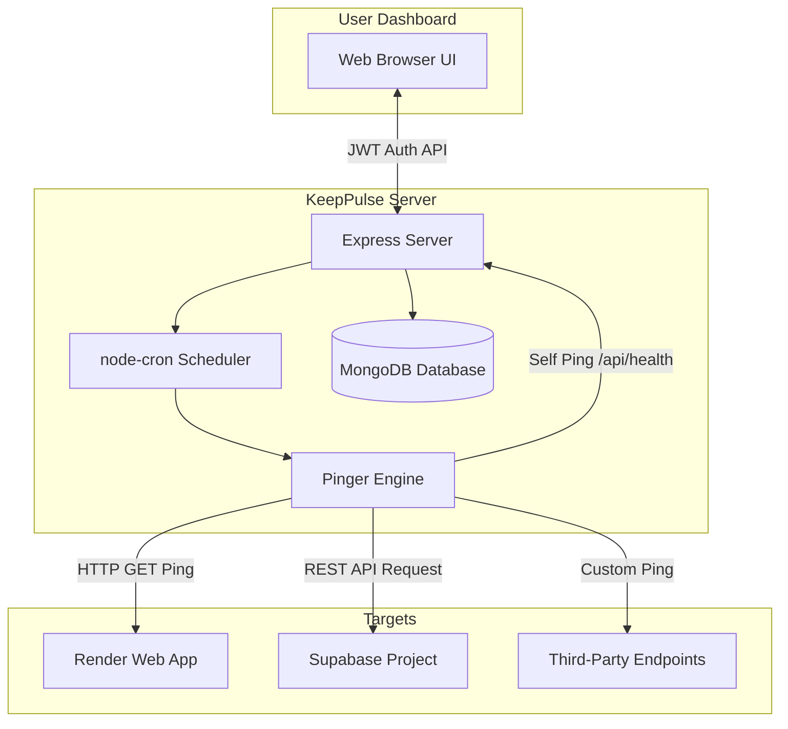

# ⚡ KeepPulse PRO — Automated Keep-Alive & Uptime Bot Service

<p align="center">
  
  
  
  
  
</p>

<p align="center">
  <b>Never let your free-tier web services sleep again!</b><br/>
  <i>KeepPulse PRO is a lightweight, automated ping & uptime monitoring bot service specifically engineered to prevent Render apps, Supabase projects, and custom HTTP endpoints from entering idle spin-down states.</i>
</p>

---

## 📌 Table of Contents

- [Overview](#-overview)
- [Key Features](#-key-features)
- [Architecture & How It Works](#-architecture--how-it-works)
- [Tech Stack](#-tech-stack)
- [Getting Started](#-getting-started)
  - [Prerequisites](#prerequisites)
  - [Installation](#installation)
  - [Environment Configuration](#environment-configuration)
- [Running the Application](#-running-the-application)
- [API Reference](#-api-reference)
- [Deployment Guide](#-deployment-guide)
- [Contributing](#-contributing)
- [License](#-license)

---

## 🚀 Overview

Free hosting tiers on platforms like **Render**, **Supabase**, **Glitch**, and **Fly.io** automatically put idle instances to sleep or pause databases after a period of inactivity. This leads to slow cold starts (15–30+ seconds) or broken service connections.

**KeepPulse PRO** solves this problem by running background cron schedules to execute automated keep-alive HTTP/HTTPS pings at configurable intervals. In addition, KeepPulse features a **Self-Ping Mechanism**, allowing the bot itself to remain online 24/7 without extra infrastructure costs.

---

## ✨ Key Features

- 🔄 **Multi-Platform Ping Targets**:
  - **Render Web Services**: Keeps free Render web apps active and warm.
  - **Supabase Projects**: Sends REST API health pings with custom API key headers to prevent project pausing.
  - **Custom Endpoints**: Monitor any public HTTP/HTTPS endpoint.
- ⏱️ **Flexible Intervals**: Set ping frequencies (e.g., 5 min, 10 min, 15 min, 30 min, 60 min) per target.
- 🛡️ **Self-Keep-Alive Mechanism**: Automatically pings its own `/api/health` endpoint so the KeepPulse bot never sleeps on Render free tier.
- 📊 **Telemetry & Activity Logs**: Real-time logging of response status codes, HTTP headers, latency (in milliseconds), and timestamp tracking stored in MongoDB.
- 🔐 **User Authentication**: Secure JWT-based authentication system with encrypted password storage via `bcryptjs`.
- 💻 **Interactive Dashboard**: Modern, clean Web UI for managing ping targets, monitoring uptime status, and viewing logs.
- 🌐 **Robust DNS Fallback**: Built-in Google & Cloudflare DNS resolver fallback (`8.8.8.8`, `1.1.1.1`) to resolve MongoDB Atlas SRV lookup issues on restrictive networks.

---

## 🏗️ Architecture & How It Works



---

## 🛠️ Tech Stack

- **Runtime & Server**: Node.js, Express.js
- **Database**: MongoDB with Mongoose ODM
- **Task Scheduling**: `node-cron`
- **Security & Auth**: JSON Web Tokens (`jsonwebtoken`), `bcryptjs`
- **Frontend**: HTML5, Modern CSS, JavaScript (SPA Dashboard), Lucide Icons
- **HTTP Client**: Native Node.js `fetch` API

---

## ⚙️ Getting Started

### Prerequisites

Ensure you have the following installed on your machine:
- [Node.js](https://nodejs.org/) (v18.0.0 or higher recommended)
- [npm](https://www.npmjs.com/) (v9.0.0 or higher)
- [MongoDB](https://www.mongodb.com/) (Local MongoDB instance or a free [MongoDB Atlas](https://www.mongodb.com/cloud/atlas) cluster)

### Installation

1. **Clone the repository:**
   ```bash
   git clone https://github.com/your-username/keep-pulse.git
   cd keep-pulse
   ```

2. **Install dependencies:**
   ```bash
   npm install
   ```

### Environment Configuration

Create a `.env` file in the root directory of the project (you can copy `.env.example`):

```bash
cp .env.example .env
```

Configure your `.env` parameters:

```env
# Server Port
PORT=3000

# MongoDB Connection String (MongoDB Atlas or Local MongoDB)
MONGODB_URI=mongodb://127.0.0.1:27017/keeppulse

# JWT Secret Key for Session Tokens
JWT_SECRET=keeppulse_super_secret_jwt_key_2026_x9z

# Public URL of deployed bot for self-ping (e.g. Render App URL)
BOT_SELF_URL=https://my-keepalive-bot.onrender.com
```

---

## 🚦 Running the Application

### Development Mode

Start the server using `server.js`:

```bash
node server.js
```

Or using `npm`:

```bash
npm run dev
```

Once started, open your browser and navigate to:
- **Dashboard UI**: `http://localhost:3000`
- **Health Check Endpoint**: `http://localhost:3000/api/health`

---

## 🔌 API Reference

### Health & Telemetry

| Method | Endpoint | Auth Required | Description |
| :--- | :--- | :--- | :--- |
| `GET` | `/api/health` | No | Returns system status, active target counts, and server uptime. |
| `GET` | `/ping` | No | Alternative lightweight health check route. |

### Authentication

| Method | Endpoint | Auth Required | Description |
| :--- | :--- | :--- | :--- |
| `POST` | `/api/auth/register` | No | Register a new user account. |
| `POST` | `/api/auth/login` | No | Authenticate user and receive JWT token. |

### Target Services Management

| Method | Endpoint | Auth Required | Description |
| :--- | :--- | :--- | :--- |
| `GET` | `/api/services` | Yes (JWT) | Fetch all active ping targets for logged-in user. |
| `POST` | `/api/services` | Yes (JWT) | Create a new target (Render / Supabase / Custom). |
| `PUT` | `/api/services/:id` | Yes (JWT) | Update target settings or toggle active state. |
| `DELETE` | `/api/services/:id` | Yes (JWT) | Delete a ping target. |
| `POST` | `/api/services/:id/ping` | Yes (JWT) | Trigger an instant manual ping for a specific target. |

### Ping Logs

| Method | Endpoint | Auth Required | Description |
| :--- | :--- | :--- | :--- |
| `GET` | `/api/logs` | Yes (JWT) | Fetch recent ping execution telemetry and logs. |

---

## ☁️ Deployment Guide

### Deploying to Render

1. Create a new **Web Service** on [Render](https://render.com/).
2. Connect your GitHub repository.
3. Configure settings:
   - **Environment**: `Node`
   - **Build Command**: `npm install`
   - **Start Command**: `node server.js`
4. Add Environment Variables:
   - `MONGODB_URI`: Your MongoDB Atlas URI.
   - `JWT_SECRET`: A strong secret string.
   - `BOT_SELF_URL`: Set to your Render service URL (e.g. `https://keep-pulse.onrender.com`).

---

## 🤝 Contributing

Contributions are welcome! If you'd like to improve KeepPulse PRO, please follow these steps:

1. Fork the Project repository.
2. Create your Feature Branch (`git checkout -b feature/AmazingFeature`).
3. Commit your Changes (`git commit -m 'Add some AmazingFeature'`).
4. Push to the Branch (`git push origin feature/AmazingFeature`).
5. Open a Pull Request.

---

## 📜 License

Distributed under the **MIT License**. See `LICENSE` for more information.

---

<p align="center">
  Made with ❤️ for developers who love free-tier hosting.
</p>
